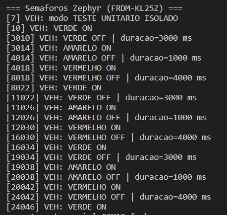
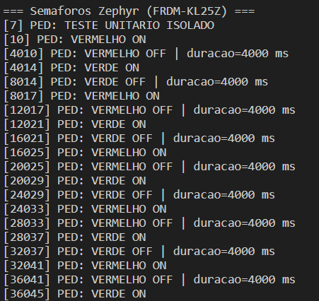
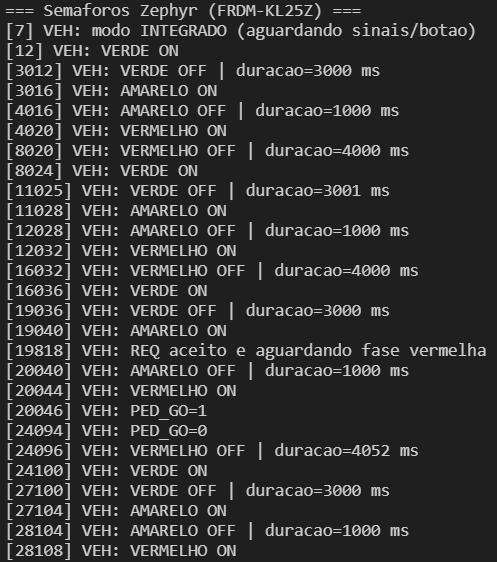
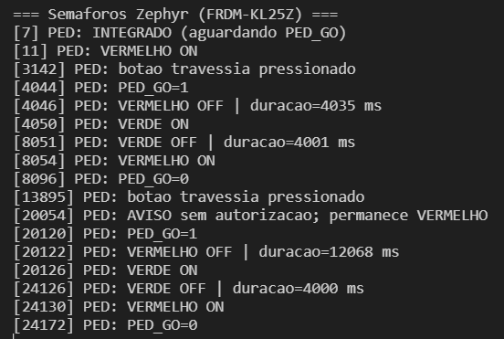
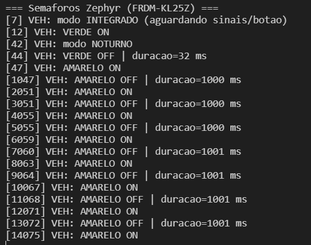
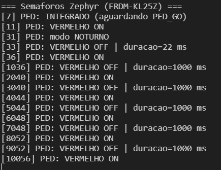
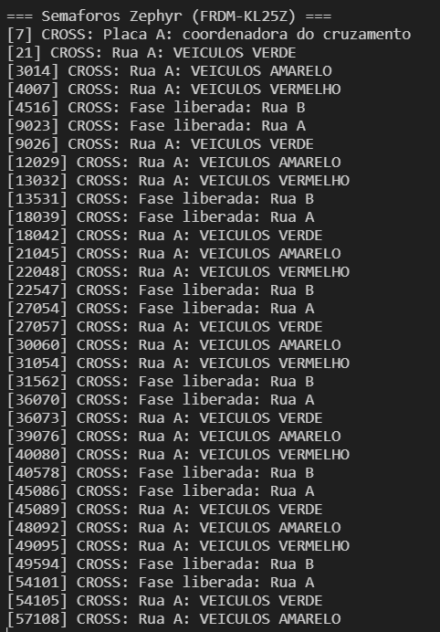
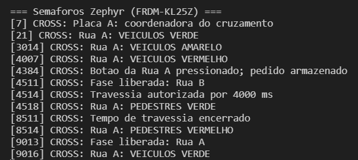
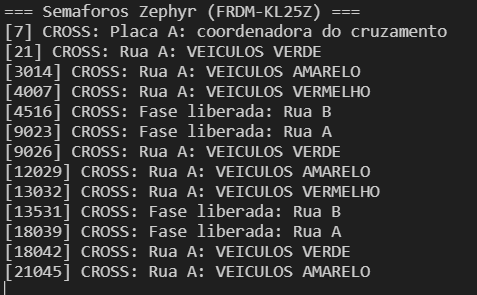
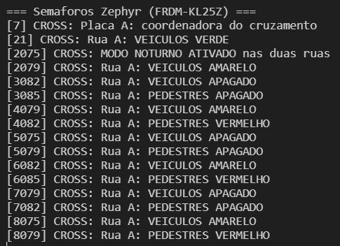

# Semáforos de Pedestres e Veículos — aplicação e implementação cruzamento com 2 placas (Zephyr / FRDM-KL25Z)

Duas placas FRDM-KL25Z, mesmo firmware; o papel é escolhido em `src/config.h`:

| Placa | Define | Função |
|---|---|---|
| A | `ROLE_STREET_A` | coordena as fases (Rua A / Rua B), lê a chave noturna, envia PHASE e NIGHT |
| B | `ROLE_STREET_B` | segue PHASE/NIGHT enviados por A |

Cada rua tem: semáforo de **veículos** = LED RGB da placa (vermelho PTB18, verde PTB19, amarelo = R+G) e semáforo de **pedestres** = 2 LEDs externos (vermelho PTC8, verde PTC9, com resistor ~330 Ω), mais 1 botão de travessia (PTD0→GND).

## Ligações

| Sinal | De → Para | Pino |
|---|---|---|
| PHASE (fase liberada: 0 = Rua A, 1 = Rua B) | A → B | PTB3 → PTB3 (J10-8) |
| NIGHT (modo noturno) | A → B | PTD4 → PTD4 (J1-6) |
| GND comum | A ↔ B | GND ↔ GND |
| Chave noturna (só na placa A) | PTA12 → GND (J1-8) | |
| Botão de travessia (cada placa) | PTD0 → GND (J2-6) | |


## Comportamento
- Ciclo de 9 s: fase A (A verde 3 s, amarelo 1 s, todos-vermelho 0,5 s) e fase B (idem com B). Vermelho de cada rua = 5 s.
- Botão: o pedido é guardado e atendido no início da fase da outra rua (própria rua vermelha): pedestre verde 4 s.
- Noturno (chave em A): amarelo veicular e vermelho de pedestres piscam 1 s aceso / 1 s apagado nas duas ruas; botões ignorados.
- B só libera sua rua após receber a 1ª borda de PHASE (falha segura).

## Compilar / gravar
1. Em `config.h` deixe só `ROLE_STREET_A` **ou** `ROLE_STREET_B` e grave cada placa (`pio run -t upload`).
2. Descubra a porta: `pio device list`. Feche o monitor serial antes de capturar.
   
## Capturar e validar logs (Windows/Linux)
```
python tools/capture_log.py COM5 a.log --seconds 60      # placa A (aperte RESET ao iniciar)
python tools/capture_log.py COM6 b.log --seconds 60      # placa B (outro terminal)
python tools/verify_log.py --a a.log --b b.log --report
```
## Simulação (sem placas)
`sh test/host/run_sim.sh` — `test/host/simulate.py` espelha `intersection.c`, gera `docs/evidencias/*.log` e `RESULTADOS.txt` (validados por `verify_log.py`).

## Testes
Plano em modelo V com resultados simulados e campos para a bancada: [`docs/PLANO_DE_TESTES.md`](docs/PLANO_DE_TESTES.md).


# Controle de Semáforos com FRDM-KL25Z e Zephyr RTOS

## PARTE 1 - APLICAÇÃO INDIVIDUAL DOS SEMÁFOROS

### 1. Introdução e Objetivos

O projeto consiste no desenvolvimento de um sistema de controle de semáforos utilizando duas placas FRDM-KL25Z, programadas em linguagem C com o sistema operacional de tempo real Zephyr RTOS.

O sistema foi dividido em duas partes: uma placa responsável pelo semáforo de veículos e outra responsável pelo semáforo de pedestres. Permitindo que os dois semáforos funcionem de maneira independente, mas também consigam se comunicar para realizar a travessia de pedestres de forma sincronizada.

Além do funcionamento normal (verde, amarelo e vermelho para o semáforo de veículos e verde e vermelho para o semáforo de pedestres), o sistema deve implementar um modo noturno, no qual os semáforos apresentam um comportamento diferente do ciclo convencional.

### 2. Organização

O projeto foi feito a partir de dois programas, identificados por `ROLE_VEHICLE` (identifica o programa responsável pelo semáforo de veículos) e `ROLE_PEDESTRIAN` (identifica o programa responsável pelo semáforo de pedestres). Essa organização permite utilizar os mesmos arquivos de infraestrutura, como `io.c` e `io.h`, em ambas as placas, mantendo as funcionalidades específicas de cada semáforo separadas.

Cada placa possui sua própria execução e controla os LEDs conectados a ela. A comunicação entre as placas é realizada por sinais digitais GPIO, que transmitem informações sobre o modo de operação e a solicitação de travessia.

### 3. Semáforo de Veículos

O semáforo de veículos foi desenvolvido com três LEDs: verde (3 segundos), amarelo (1 segundo) e vermelho (4 segundos). Para organizar o funcionamento, foram utilizadas três threads independentes, sendo uma responsável por cada LED. Cada thread verifica se chegou sua vez de acender o respectivo LED, e para evitar que duas threads acendam LEDs simultaneamente, foi implementado um mecanismo de exclusão mútua utilizando `k_mutex`.

Também foi utilizada uma variável compartilhada (`lit`), responsável por indicar qual LED está aceso naquele momento, evitando possíveis problemas. Dessa forma, uma thread só pode acender seu LED quando não houver outro LED ocupando esse estado. E para controlar os períodos de funcionamento, foram utilizadas condition variables, já que elas possibilitam que as threads consigam aguardar o tempo necessário sem manter o mutex bloqueado durante toda a espera, permitindo que outras threads e o programa principal continuem executando.



*Teste do semáforo de veículo isolado*

▶️ [Assista ao vídeo: semáforo de veículo, teste individual](https://drive.google.com/file/d/18-tM2DNU3FchWai2_TizUR-ABLuN-_sz/view?usp=drive_link)

### 4. Semáforo de Pedestres

O semáforo de pedestres possui dois LEDs: verde e vermelho, sendo organizado em duas threads independentes, uma para cada LED. No funcionamento normal, o semáforo permanece vermelho enquanto não recebe uma autorização de travessia da placa responsável pelos veículos. Agora, quando a placa de veículos identifica uma solicitação de travessia e chega à fase vermelha, ela envia um sinal digital chamado `PED_GO` para a placa de pedestres.

Ao receber esse sinal, o semáforo de pedestres pode iniciar a travessia, acendendo o LED verde durante o período de 4 segundos. Após esse intervalo, o LED verde é desligado e o sistema retorna à condição de espera no LED vermelho. Evitando assim que os LEDs sejam acionados simultaneamente.



*Teste do semáforo de pedestre isolado*

▶️ [Assista ao vídeo: semáforo de pedestre, teste individual](https://drive.google.com/file/d/1XlsfbqTmaGwnVsi7HfCbJC_v1_W-h02W/view?usp=drive_link)

### 5. Comunicação

Para permitir a integração dos dois semáforos, foram utilizadas três linhas de comunicação GPIO: `PED_GO` (autoriza a travessia de pedestres), `NIGHT` (informa quando o sistema está no modo noturno) e `REQ` (envia uma solicitação de travessia do pedestre).

O funcionamento da comunicação ocorre da seguinte maneira:

1. O pedestre pressiona o botão de solicitação de travessia.
2. A placa de pedestres identifica o acionamento e envia um pulso pelo sinal `REQ`.
3. A placa de veículos recebe a solicitação e armazena essa informação.
4. Quando o semáforo de veículos chega à fase vermelha, a placa envia o sinal `PED_GO`.
5. A placa de pedestres recebe a autorização e inicia a fase verde.
6. Após o período de travessia, o sistema retorna à condição normal de espera.

Foi implementado também um mecanismo para evitar solicitações duplicadas: caso já exista uma solicitação pendente, novos pedidos não são armazenados como novas solicitações. Além disso, as solicitações recebidas durante o modo noturno são ignoradas.

### 6. Botão de Travessia

O botão de travessia foi conectado à placa responsável pelo semáforo de pedestres e a entrada é configurada com resistor interno de pull-up (`GPIO_PULL_UP`), permitindo identificar o acionamento por meio da mudança do nível lógico do pino e, depois de identificar o acionamento, a placa envia um pulso pelo sinal `REQ` para a placa de veículos. Além disso, para evitar que pequenas oscilações elétricas provoquem múltiplas detecções de um único acionamento, foi utilizado um mecanismo de debounce (para que ocorra apenas depois de estabilizar).

Durante a solicitação de travessia, o tempo em que o semáforo de veículos permanece vermelho é ajustado para garantir que os pedestres tenham tempo suficiente para realizar a travessia em teoria. Quando a placa de veículos recebe uma solicitação (`REQ`), ela aguarda até atingir a fase vermelha e, então, envia o sinal `PED_GO = 1` para a placa de pedestres, autorizando o acionamento do LED verde. Esse sinal permanece ativo durante o período de travessia, definido em 4 segundos, e após esse intervalo o LED verde do semáforo de pedestres é desligado e o LED vermelho é acionado e a autorização é encerrada com o envio de `PED_GO = 0`. Dessa forma, o controle do tempo de travessia fica sincronizado com o semáforo de veículos, evitando que os veículos realizem a passagem antes do encerramento do período destinado aos pedestres.



*Semáforo de veículo ao ativar botão de travessia*



*Semáforo de pedestre com botão de travessia ativado*

▶️ [Assista ao vídeo: rua única, teste do botão de travessia](https://drive.google.com/file/d/1KtaekKDEg6nlE1tmzTGMiEjqWrgx9oPM/view?usp=drive_link)

### 7. Modo Noturno

O modo noturno foi implementado na placa de veículos para alterar o comportamento dos dois semáforos simultaneamente. Quando a chave de seleção é acionada, o programa identifica a mudança de estado e altera a variável `cur_mode` para `MODE_NIGHT`, enviando essa informação também para a placa de pedestres por meio do sinal `NIGHT`.

Para implementar esse comportamento, as threads verificam o valor de `cur_mode`. Quando o modo noturno está ativo, as threads responsáveis pelos LEDs correspondentes passam a executar a sequência de acionamento e desligamento periódico.



*Semáforo de veículos no modo noturno*



*Semáforo de pedestre no modo noturno*

▶️ [Assista ao vídeo: rua única no modo noturno](https://drive.google.com/file/d/1ayxYaflsl1oNMfPrtFUto1_MZHGb9vWs/view?usp=drive_link)

### 8. Testes

Os testes foram realizados considerando o funcionamento individual das placas e a comunicação entre elas, e todos os testes possíveis foram concluídos com sucesso.

A utilização de mensagens no Serial Monitor também permite acompanhar eventos importantes, como mudanças de modo, acionamento dos LEDs e envio dos sinais de comunicação.

---

## PARTE 2 - IMPLEMENTAÇÃO DE CRUZAMENTO DE SEMÁFOROS

### 9. Mudanças para o Novo Modelo

Com os modelos individuais prontos, foi necessária a implementação da nova parte do projeto, a qual consiste em um cruzamento de semáforos. Para organizar o desenvolvimento e a validação do sistema, foi adotado como referência o Modelo V, uma metodologia que relaciona cada etapa de desenvolvimento a uma etapa correspondente de testes. Assim, os requisitos definidos inicialmente são utilizados como referência para verificar se a implementação final atende ao comportamento esperado.

O Modelo V foi aplicado considerando quatro níveis principais de desenvolvimento: requisitos do sistema, arquitetura, projeto dos componentes e implementação. Para cada nível, foram relacionados os testes de aceitação, testes de sistema, testes de integração e testes de unidade, respectivamente.

### 10. Como Deveria Funcionar

O sistema deveria representar um cruzamento com duas vias, controlando os semáforos de veículos e pedestres de maneira sincronizada. Com as seguintes funcionalidades:

- controle dos semáforos de veículos
- controle dos semáforos de pedestres
- sincronização das vias
- solicitação de travessia
- modo noturno
- comportamento dos pedestres no modo noturno

### 11. Arquitetura do Sistema

Foram utilizadas duas placas FRDM-KL25Z, cada uma responsável por uma das vias do cruzamento. A placa A foi definida como unidade principal de coordenação, enquanto a placa B acompanha as informações transmitidas pela primeira placa.

#### 11.1. Hardware

Cada placa possui um LED RGB integrado, utilizado para representar o semáforo de veículos. E para os semáforos de pedestres, foram utilizados dois LEDs externos em cada placa: um vermelho e um verde.

Os LEDs externos utilizados são ativos em nível alto, diferentemente dos canais do LED RGB integrado. Essa diferença foi considerada na implementação das funções de controle.

#### 11.2. Comunicação

A comunicação entre as duas placas foi realizada utilizando sinais digitais transmitidos por pinos GPIO. Assim, foram definidos sinais para transmitir as informações relacionadas à fase dos semáforos e ao modo noturno, considerando também a comunicação de solicitações de travessia provenientes da placa B. Já o sinal `PHASE` é utilizado para transmitir informações relacionadas à fase de funcionamento dos semáforos e o sinal `NIGHT` informa a ativação ou desativação do modo noturno.

### 12. Testes dos Códigos e Funcionamento

O software foi dividido em módulos para facilitar a manutenção, a compreensão e a reutilização das funções. O módulo de entrada e saída, formado pelos arquivos `io.h` e `io.c`, concentra todo o acesso ao hardware: inicializa os pinos dos LEDs, configura os botões e os pinos de comunicação, controla os canais do LED RGB, etc. Ademais, o Zephyr RTOS organiza o sistema em threads, separando as responsabilidades de controle dos semáforos, leitura dos botões, comunicação entre as placas e monitoramento do modo noturno. O escalonador permite que essas tarefas rodem de forma concorrente, uma vez que enquanto uma aguarda o fim de um intervalo, outra continua monitorando entradas ou comunicando.

A lógica dos semáforos de veículos alterna a autorização de passagem entre as duas vias em quatro etapas: uma via recebe verde enquanto a outra fica no vermelho; o verde dá lugar ao amarelo; ocorre então um intervalo de segurança com ambos os sinais vermelhos; e a outra via recebe o verde, repetindo-se a sequência para ela. As durações de cada estado são definidas por parâmetros no código, podendo ser ajustadas, e o intervalo de segurança evita liberar uma via enquanto a outra ainda está encerrando sua passagem. Já os semáforos de pedestres, controlados por LEDs externos em cada placa, têm dois estados (vermelho, travessia não liberada, e verde, travessia liberada), e sua lógica considera a fase dos veículos e as condições de segurança, mantendo-se sincronizada ao funcionamento geral do cruzamento. Já o modo noturno é ativado por um interruptor ligado à placa A, que transmite o estado à placa B pelo sinal `NIGHT`; nesse modo, os semáforos de veículos passam a piscar em amarelo e os LEDs vermelhos dos pedestres também piscam, permitindo que um único interruptor altere o comportamento das duas vias.



*Semáforo com cruzamento funcionamento normal*



*Semáforo A do cruzamento ligado*



*Semáforo B do cruzamento ligado*



*Semáforos com cruzamento no modo noturno ligado*

▶️ [Assista ao vídeo: cruzamento de ruas em todos os modos (noturno, padrão e travessia)](https://drive.google.com/file/d/1qwPRwWIULhoAoACu9r5Ef0-dFN1VYoKG/view?usp=drive_link)

### 13. Avaliações e Versionamento

O Modelo V destaca a importância da revisão por pares e do versionamento durante o desenvolvimento de sistemas embarcados. Isso consiste em permitir que outra pessoa analise o código, revise a lógica implementada e execute os testes definidos. E essa prática pode ajudar a identificar erros que não foram percebidos durante o desenvolvimento individual, além de melhorar a compreensão do funcionamento do sistema.

O versionamento, por sua vez, permite registrar as alterações realizadas no código ao longo do projeto. Ferramentas como Git e GitHub foram utilizadas para manter um histórico das implementações, correções e versões testadas.
