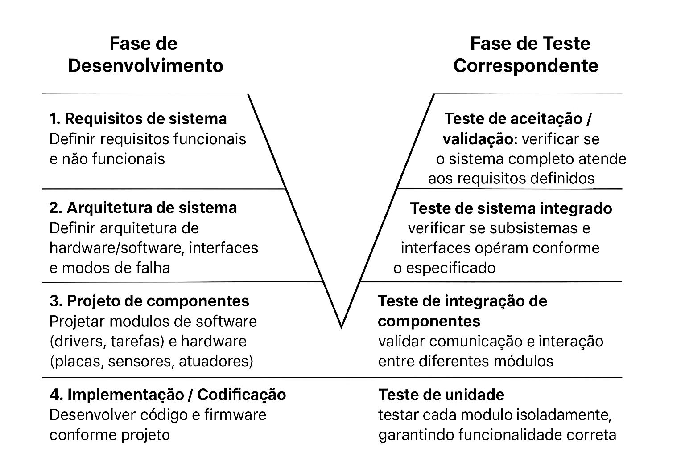

# Plano de Testes — Semáforos de Pedestres e Veículos (Modelo V)

Dupla: ____________ (placa de pedestres) / ____________ (placa de veículos) — Data: ____

## 1. Modelo V aplicado

| Fase de desenvolvimento | Atividade neste projeto | Nível de teste |
|---|---|---|
| 1. Requisitos de sistema | RF1–RF5 e RNF (seção 2) | **Aceitação / validação (TA)** |
| 2. Arquitetura de sistema | 2 placas, 3 sinais (PED_GO, NIGHT, REQ), modos normal/noturno/travessia | **Sistema integrado (TS)** |
| 3. Projeto de componentes | módulos `pedestrian.c`, `vehicle.c`, `io.c`; comunicação entre semáforos | **Integração de componentes (TI)** |
| 4. Implementação | código e threads de cada LED | **Unidade (TU)** |

Todo teste segue: **pré-condição → etapas → pós-condição**, escrito para que outro desenvolvedor o reproduza.

**Instrumentação:** log serial 115200 com timestamp (`[ms] TAG: msg`) gerado no instante da transição do LED; cronômetro/analisador lógico como referência. Tolerância ± 60 ms (polling 10 ms + debounce). Validação automática: `python3 tools/verify_log.py --veh veh.log --ped ped.log`.

## 2. Requisitos e rastreabilidade

| Req. | Descrição | Testes |
|---|---|---|
| RF1 | Pedestre: verde 4 s, vermelho 4 s, 2 threads, mutex | TU-P1..P4, TA-1 |
| RF2 | Veículo: verde 3 s, amarelo 1 s, vermelho 4 s, 3 threads, mutex | TU-V1..V4, TA-2 |
| RF3 | Sincronismo pedestre × veículo | TI-1..TI-7, TI-11, TA-3 |
| RF4 | Modo noturno (amarelo/vermelho 1 s ligado, 1 s apagado) | TI-10, TS-4..TS-8, TA-4 |
| RF5 | Botão de travessia, via única, carros bloqueados com segurança | TI-2, TI-5, TI-6, TS-2, TS-3, TA-5 |
| RNF | Debounce, falha segura, robustez a race conditions | TU-IO1..IO4, TI-8, TI-9, TS-7, TS-9, TS-10 |

## 3. Testes de Unidade (Implementação → cada módulo isolado)

Preparação: ativar `PED_STANDALONE_TEST` ou `VEH_STANDALONE_TEST` em `config.h` (sem fios/entradas). Cada placa testada sozinha.
### TU-P1 — Pedestre: tempo do verde (RF1)
- **Pré-condição:** Placa PED com `PED_STANDALONE_TEST`; monitor serial aberto; LEDs apagados no boot.
- **Etapas:** 1. Ligar a placa. 2. Registrar ≥ 3 ciclos. 3. Ler `VERDE OFF | duracao`.
- **Pós-condição (esperado):** `duracao` = 4000 ± 60 ms em todos os ciclos.
- **Obtido:** ________  **Resultado:** ☐ Passou ☐ Falhou  **Executor/Revisor:** ________
### TU-P2 — Pedestre: tempo do vermelho (RF1)
- **Pré-condição:** Idem TU-P1.
- **Etapas:** 1. Registrar ≥ 3 ciclos. 2. Ler `VERMELHO OFF | duracao`.
- **Pós-condição (esperado):** `duracao` = 4000 ± 60 ms; alterna com o verde.
- **Obtido:** ________  **Resultado:** ☐ Passou ☐ Falhou  **Executor/Revisor:** ________
### TU-P3 — Pedestre: exclusão mútua entre as 2 threads (RF1)
- **Pré-condição:** Idem TU-P1.
- **Etapas:** 1. Observar LEDs por 2 min. 2. Rodar `verify_log.py --ped ped.log --ped-standalone`.
- **Pós-condição (esperado):** Nunca verde e vermelho acesos juntos; `FAIL=0`; nenhum `ON` sem `OFF` anterior.
- **Obtido:** ________  **Resultado:** ☐ Passou ☐ Falhou  **Executor/Revisor:** ________
### TU-P4 — Pedestre: uma thread por LED (RF1)
- **Pré-condição:** Código-fonte `pedestrian.c`.
- **Etapas:** 1. Conferir `k_thread_create` ×2 (VERDE, VERMELHO). 2. Conferir uso de `lock` em `led_take/led_release`.
- **Pós-condição (esperado):** 2 threads independentes; todo acesso a `lit`/LED sob o mutex.
- **Obtido:** ________  **Resultado:** ☐ Passou ☐ Falhou  **Executor/Revisor:** ________
### TU-V1 — Veículo: tempos verde/amarelo/vermelho (RF2)
- **Pré-condição:** Placa VEH com `VEH_STANDALONE_TEST`; monitor aberto.
- **Etapas:** 1. Ligar. 2. Registrar ≥ 3 ciclos completos.
- **Pós-condição (esperado):** VERDE 3000, AMARELO 1000, VERMELHO 4000 (± 60 ms).
- **Obtido:** ________  **Resultado:** ☐ Passou ☐ Falhou  **Executor/Revisor:** ________
### TU-V2 — Veículo: ordem do ciclo (RF2)
- **Pré-condição:** Idem TU-V1.
- **Etapas:** 1. Observar sequência no log.
- **Pós-condição (esperado):** VERDE → AMARELO → VERMELHO → VERDE, sem pular fase.
- **Obtido:** ________  **Resultado:** ☐ Passou ☐ Falhou  **Executor/Revisor:** ________
### TU-V3 — Veículo: exclusão mútua das 3 threads (RF2)
- **Pré-condição:** Idem TU-V1.
- **Etapas:** 1. Observar LEDs (amarelo = R+G). 2. `verify_log.py --veh veh.log`.
- **Pós-condição (esperado):** Exatamente 1 LED lógico aceso por vez; `FAIL=0`.
- **Obtido:** ________  **Resultado:** ☐ Passou ☐ Falhou  **Executor/Revisor:** ________
### TU-V4 — Veículo: deriva em operação contínua (RNF)
- **Pré-condição:** Idem TU-V1.
- **Etapas:** 1. Registrar 10 ciclos (80 s).
- **Pós-condição (esperado):** Período do ciclo = 8000 ms com deriva acumulada < 100 ms.
- **Obtido:** ________  **Resultado:** ☐ Passou ☐ Falhou  **Executor/Revisor:** ________
### TU-IO1 — Debounce: ruído curto ignorado (RNF)
- **Pré-condição:** Modo integrado, placa sozinha; botão/chave ligados ao GND.
- **Etapas:** 1. Tocar o fio rapidamente (< 20 ms). 
- **Pós-condição (esperado):** Nenhum evento no log.
- **Obtido:** ________  **Resultado:** ☐ Passou ☐ Falhou  **Executor/Revisor:** ________
### TU-IO2 — Debounce: acionamento firme (RNF)
- **Pré-condição:** Idem TU-IO1.
- **Etapas:** 1. Pressionar firme ≥ 40 ms.
- **Pós-condição (esperado):** Exatamente 1 evento (`modo …` ou `botao travessia pressionado`).
- **Obtido:** ________  **Resultado:** ☐ Passou ☐ Falhou  **Executor/Revisor:** ________
### TU-IO3 — Botão: borda única (RNF)
- **Pré-condição:** Idem TU-IO1 (placa PED).
- **Etapas:** 1. Segurar o botão por 3 s.
- **Pós-condição (esperado):** 1 único pulso REQ de ~300 ms (um evento no log).
- **Obtido:** ________  **Resultado:** ☐ Passou ☐ Falhou  **Executor/Revisor:** ________
### TU-IO4 — Validador de logs (ferramenta)
- **Pré-condição:** PC com Python 3.
- **Etapas:** 1. `sh test/host/run_selftest.sh`.
- **Pós-condição (esperado):** Log correto = PASS; log com falha injetada = FAIL (rejeitado).
- **Obtido:** ________  **Resultado:** ☐ Passou ☐ Falhou  **Executor/Revisor:** ________

## 4. Testes de Integração de Componentes (Projeto de componentes → módulos + interação entre os semáforos)

Preparação: flags de teste comentadas, duas placas ligadas (PED_GO, NIGHT, REQ, GND). Capturar `veh.log` e `ped.log`.
### TI-1 — Enlace PED_GO (VEH → PED)
- **Pré-condição:** Ambas as placas ligadas e em modo normal; sem pedido pendente.
- **Etapas:** 1. Apertar o botão. 2. Aguardar o próximo VEH VERMELHO. 3. Comparar `PED_GO=1` nos dois logs.
- **Pós-condição (esperado):** PED registra `PED_GO=1` ≤ 50 ms após a VEH.
- **Obtido:** ________  **Resultado:** ☐ Passou ☐ Falhou  **Executor/Revisor:** ________
### TI-2 — Pedido durante VERDE/AMARELO é adiado
- **Pré-condição:** Modo normal; VEH em VERDE.
- **Etapas:** 1. Apertar o botão durante o verde. 2. Observar até o fim do ciclo.
- **Pós-condição (esperado):** VEH: `REQ aceito`; PED continua VERMELHO; PED VERDE só após VEH VERMELHO ON.
- **Obtido:** ________  **Resultado:** ☐ Passou ☐ Falhou  **Executor/Revisor:** ________
### TI-3 — Sincronismo PED×VEH (RF3)
- **Pré-condição:** Modo normal.
- **Etapas:** 1. Gerar ≥ 5 travessias. 2. `verify_log.py --veh veh.log --ped ped.log`.
- **Pós-condição (esperado):** PED VERDE contido em VEH VERMELHO; sem sobreposição com VEH verde/amarelo; `FAIL=0`.
- **Obtido:** ________  **Resultado:** ☐ Passou ☐ Falhou  **Executor/Revisor:** ________
### TI-4 — Margem de segurança no fim da travessia
- **Pré-condição:** Idem TI-3.
- **Etapas:** 1. Medir `PED VERDE OFF` vs `VEH VERMELHO OFF`.
- **Pós-condição (esperado):** PED apaga o verde antes de VEH acender o verde (margem ≥ 20 ms).
- **Obtido:** ________  **Resultado:** ☐ Passou ☐ Falhou  **Executor/Revisor:** ________
### TI-5 — Pedido durante o VEH VERMELHO sem pedido prévio
- **Pré-condição:** Modo normal; VEH acabou de acender VERMELHO sem pedido.
- **Etapas:** 1. Apertar o botão no meio do vermelho.
- **Pós-condição (esperado):** Pedido fica pendente para o próximo ciclo; vermelho atual não é estendido.
- **Obtido:** ________  **Resultado:** ☐ Passou ☐ Falhou  **Executor/Revisor:** ________
### TI-6 — Pedidos duplicados
- **Pré-condição:** Modo normal; VEH em VERDE.
- **Etapas:** 1. Apertar o botão 3× antes do vermelho.
- **Pós-condição (esperado):** Log: 1 `REQ aceito` + `REQ duplicado`; uma única travessia.
- **Obtido:** ________  **Resultado:** ☐ Passou ☐ Falhou  **Executor/Revisor:** ________
### TI-7 — Sem pedido: ciclo veicular inalterado
- **Pré-condição:** Modo normal.
- **Etapas:** 1. Não apertar o botão por 1 min.
- **Pós-condição (esperado):** VEH vermelho = 4000 ms; PED permanece VERMELHO; PED_GO=0.
- **Obtido:** ________  **Resultado:** ☐ Passou ☐ Falhou  **Executor/Revisor:** ________
### TI-8 — Falha segura: fio PED_GO desconectado
- **Pré-condição:** Modo normal.
- **Etapas:** 1. Desconectar PED_GO. 2. Apertar o botão. 3. Aguardar 12 s.
- **Pós-condição (esperado):** PED permanece VERMELHO; log `AVISO sem autorizacao`.
- **Obtido:** ________  **Resultado:** ☐ Passou ☐ Falhou  **Executor/Revisor:** ________
### TI-9 — Falha: fio REQ desconectado
- **Pré-condição:** Modo normal.
- **Etapas:** 1. Desconectar REQ. 2. Apertar o botão.
- **Pós-condição (esperado):** Veículos seguem o ciclo normal sem travar; nenhuma travessia.
- **Obtido:** ________  **Resultado:** ☐ Passou ☐ Falhou  **Executor/Revisor:** ________
### TI-10 — Enlace NIGHT (VEH → PED)
- **Pré-condição:** Modo normal.
- **Etapas:** 1. Ligar a chave noturna na VEH.
- **Pós-condição (esperado):** PED registra `modo NOTURNO` ≤ 50 ms depois da VEH.
- **Obtido:** ________  **Resultado:** ☐ Passou ☐ Falhou  **Executor/Revisor:** ________
### TI-11 — Exclusão mútua inter-placas
- **Pré-condição:** Logs de TI-1 a TI-10.
- **Etapas:** 1. Rodar o validador em todos os logs.
- **Pós-condição (esperado):** Em nenhum instante PED VERDE coincide com VEH VERDE/AMARELO.
- **Obtido:** ________  **Resultado:** ☐ Passou ☐ Falhou  **Executor/Revisor:** ________

## 5. Testes de Sistema Integrado (Arquitetura → sistema completo: modos noturno e botão)

Preparação: mesma de integração; bancada com as duas placas e cronômetro/analisador lógico como referência independente.
### TS-1 — Modo normal contínuo
- **Pré-condição:** Placas recém-ligadas.
- **Etapas:** 1. Deixar rodar 2 min sem interação.
- **Pós-condição (esperado):** Ciclo VEH de 8 s estável; PED vermelho fixo.
- **Obtido:** ________  **Resultado:** ☐ Passou ☐ Falhou  **Executor/Revisor:** ________
### TS-2 — Travessia por botão
- **Pré-condição:** Modo normal.
- **Etapas:** 1. Apertar o botão em qualquer fase.
- **Pós-condição (esperado):** Na próxima fase VEH vermelha: PED verde 4000 ± 60 ms; carros bloqueados durante todo o verde.
- **Obtido:** ________  **Resultado:** ☐ Passou ☐ Falhou  **Executor/Revisor:** ________
### TS-3 — Via única: pedido durante travessia
- **Pré-condição:** Travessia em andamento (PED verde).
- **Etapas:** 1. Apertar o botão repetidamente.
- **Pós-condição (esperado):** Novo pedido fica pendente para o ciclo seguinte; sem conflito de LEDs.
- **Obtido:** ________  **Resultado:** ☐ Passou ☐ Falhou  **Executor/Revisor:** ________
### TS-4 — Noturno – veículos
- **Pré-condição:** Modo normal.
- **Etapas:** 1. Ligar a chave noturna.
- **Pós-condição (esperado):** Amarelo 1 s aceso / 1 s apagado; verde e vermelho apagados.
- **Obtido:** ________  **Resultado:** ☐ Passou ☐ Falhou  **Executor/Revisor:** ________
### TS-5 — Noturno – pedestres
- **Pré-condição:** Idem TS-4.
- **Etapas:** 1. Observar a placa PED.
- **Pós-condição (esperado):** Vermelho 1 s / 1 s; verde apagado.
- **Obtido:** ________  **Resultado:** ☐ Passou ☐ Falhou  **Executor/Revisor:** ________
### TS-6 — Botão no modo noturno
- **Pré-condição:** Modo noturno ativo.
- **Etapas:** 1. Apertar o botão.
- **Pós-condição (esperado):** Log `REQ ignorado: modo noturno`; nenhuma travessia.
- **Obtido:** ________  **Resultado:** ☐ Passou ☐ Falhou  **Executor/Revisor:** ________
### TS-7 — Entrada no noturno durante travessia (concorrência)
- **Pré-condição:** PED verde aceso, VEH vermelho.
- **Etapas:** 1. Ligar a chave noturna.
- **Pós-condição (esperado):** PED verde apaga de imediato e o vermelho passa a piscar; nunca 2 LEDs simultâneos (race condition).
- **Obtido:** ________  **Resultado:** ☐ Passou ☐ Falhou  **Executor/Revisor:** ________
### TS-8 — Saída do noturno
- **Pré-condição:** Modo noturno ativo.
- **Etapas:** 1. Desligar a chave.
- **Pós-condição (esperado):** VEH reinicia em VERDE; PED em VERMELHO; sem pedido residual.
- **Obtido:** ________  **Resultado:** ☐ Passou ☐ Falhou  **Executor/Revisor:** ________
### TS-9 — Estresse / race conditions
- **Pré-condição:** Modo normal.
- **Etapas:** 1. 30 min com botão e chave acionados em instantes aleatórios. 2. `verify_log.py`.
- **Pós-condição (esperado):** `FAIL=0`; sem travamento; sem LED duplo.
- **Obtido:** ________  **Resultado:** ☐ Passou ☐ Falhou  **Executor/Revisor:** ________
### TS-10 — Reset de uma placa
- **Pré-condição:** Sistema em operação.
- **Etapas:** 1. Dar reset em uma placa.
- **Pós-condição (esperado):** Reinicia em estado seguro (PED vermelho) e volta a sincronizar.
- **Obtido:** ________  **Resultado:** ☐ Passou ☐ Falhou  **Executor/Revisor:** ________

## 6. Testes de Aceitação / Validação (Requisitos → checklist final do enunciado)

Preparação: sistema completo em ambiente representativo (bancada), avaliador diferente do autor (par).
### TA-1 — Pedestres: 2 LEDs, 4 s / 4 s, 2 threads, mutex
- **Pré-condição:** TU-P1..P4 aprovados.
- **Etapas:** 1. Conferir resultados e código.
- **Pós-condição (esperado):** Todos OK.
- **Obtido:** ________  **Resultado:** ☐ Passou ☐ Falhou  **Executor/Revisor:** ________
### TA-2 — Veículos: 3 LEDs, 3/1/4 s, 3 threads, mutex
- **Pré-condição:** TU-V1..V4 aprovados.
- **Etapas:** 1. Conferir resultados e código.
- **Pós-condição (esperado):** Todos OK.
- **Obtido:** ________  **Resultado:** ☐ Passou ☐ Falhou  **Executor/Revisor:** ________
### TA-3 — Sincronismo PED×VEH
- **Pré-condição:** TI-1..TI-11 aprovados.
- **Etapas:** 1. Conferir logs.
- **Pós-condição (esperado):** Todos OK.
- **Obtido:** ________  **Resultado:** ☐ Passou ☐ Falhou  **Executor/Revisor:** ________
### TA-4 — Modo noturno
- **Pré-condição:** TS-4..TS-8 aprovados.
- **Etapas:** 1. Demonstrar ao avaliador.
- **Pós-condição (esperado):** Pisca 1 s/1 s nas duas placas.
- **Obtido:** ________  **Resultado:** ☐ Passou ☐ Falhou  **Executor/Revisor:** ________
### TA-5 — Botão de travessia, via única, bloqueio seguro dos carros
- **Pré-condição:** TS-2, TS-3 aprovados.
- **Etapas:** 1. Demonstrar ao avaliador.
- **Pós-condição (esperado):** Carros bloqueados antes do verde do pedestre; sem conflito.
- **Obtido:** ________  **Resultado:** ☐ Passou ☐ Falhou  **Executor/Revisor:** ________

## 7. Avaliação por pares
Cada integrante **executa os testes sobre o código do colega** (placa/módulo que não escreveu) e registra feedback.

| Testes revisados | Autor do código | Revisor | Falhas/observações | Data |
|---|---|---|---|---|
| | | | | |

## 8. Defeitos e versionamento
Marcos de commit sugeridos (cada integrante commita com o próprio usuário Git): (1) código original; (2) 1ª falha detectada (log anexado); (3) correção aplicada; (4) validação final com todos os testes aprovados.

| Defeito | Teste | Causa | Commit da correção | Re-teste |
|---|---|---|---|---|
| | | | | |

Anexar: `veh.log`, `ped.log`, saída do `verify_log.py`, fotos/vídeo.
